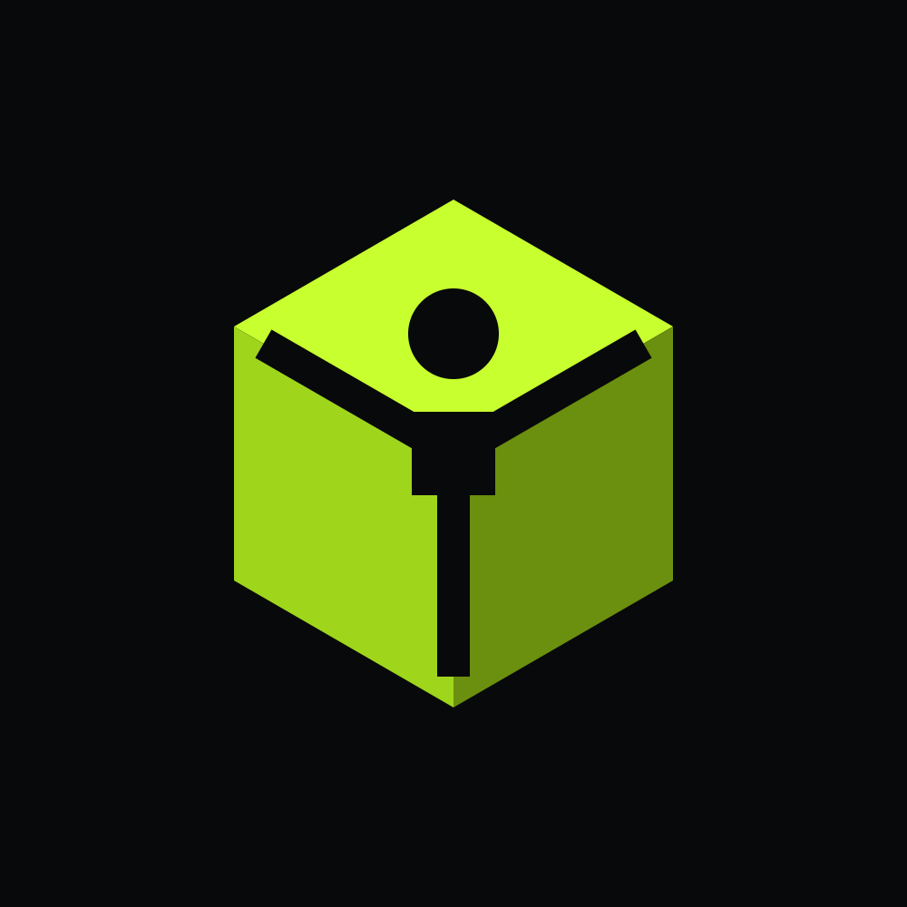

# Tridi

**Convertimos video humano en datos de entrenamiento y políticas listas para robots humanoides y físicos.**

Grabas a una persona moviéndose con el celular. Un humanoide aprende a hacerlo igual practicando en física real (MuJoCo) hasta no caerse — y el mismo pipeline entrena y transfiere políticas ONNX Sim-to-Real a robots físicos reales.

👉 **Demo en vivo:** [tridi-alpha.vercel.app](https://tridi-alpha.vercel.app) · **Hitos Sim-to-Real:** [tridi-alpha.vercel.app/#/milestones](https://tridi-alpha.vercel.app/#/milestones) · **Pitch:** [`docs/pitch/tridi-pitch.pdf`](docs/pitch/tridi-pitch.pdf)

## El problema

ChatGPT se entrenó con todo internet. Los robots no tienen nada parecido: no existe un internet de datos de movimiento con fuerzas reales. Hoy, enseñarle un movimiento nuevo a un humanoide exige trajes de captura, teleoperación cara y estudios con pisos perfectos que en el mundo físico no existen.

## Qué hace Tridi

- **Tridi Capture 2.0:** de un video de celular o cámara en vivo sacamos el cuerpo 3D en coordenadas del mundo (`GVHMR` / SMPL-X, 33 puntos a 30 fps) más manos de 21 puntos (`WiLoR`, 5 dedos con $< 2\text{ cm}$ de error de punta) y lo retargeteamos a humanoides (`Unitree G1`, `Unitree H1`).
- **Tridi Gym:** si el robot solo copia el video, se cae. El video le dice qué hacer; la física le enseña cómo. Una red neuronal practica el movimiento millones de veces en MuJoCo bajo gravedad, fricción, objetos, líquidos y empujones en cuatro terrenos (`plano`, `piedras`, `resbaloso`, `viento`).
- **Tridi Policy & Sim-to-Real:** entrega el dataset físico (`PoseClip` + `RobotMotion` + rollouts) y la política entrenada en **ONNX** lista para correr a 50 Hz en el navegador (WASM) o transferir **zero-shot Sim-to-Real** a hardware físico real.

## Dónde estamos

| Estado | Qué hace hoy en producción ([`trytridi.com`](https://trytridi.com)) |
| --- | --- |
| **Equilibrio (`Stand v2`, 300M pasos)** | El Unitree G1 se mantiene de pie en los 4 terrenos y recupera **4,0 / 4 empujones de 250 N** (y hasta 320–350 N) con paso reactivo de Capture Point |
| **Imitación v2 (9 políticas ONNX)** | Camina (`g1-walk`, `h1-walk`), corre (`g1-run`), salta (`g1-jacks`), baila (`g1-bailar`), saluda (`g1-saludar`), cuenta con los 5 dedos (`g1-dedos`), se sienta (`g1-sentarse`) e interactúa con objetos y agua |
| **Sim-to-Real físico (`luigi_lab3`)** | Primer caso de estudio completo ([`#/milestones`](https://tridi-alpha.vercel.app/#/milestones)): gemelo digital en MuJoCo desde planos CAD (`.stl`) + política PPO ONNX (17 KB) transferida zero-shot al robot físico real (Arduino UNO + L298N + HC-SR04 + 4× CNY70) y por WebSerial a 50 Hz |

## El repo

| Carpeta | Qué es |
| --- | --- |
| [`data/`](data/README.md) | Video o cámara → `PoseClip` v2 (`GVHMR + WiLoR`, cuerpo + manos de 21 puntos), relay WebSocket y servidor de video (`data/server.py`) |
| [`physics/`](physics/README.md) | `Unitree G1`, `Unitree H1` y `luigi_lab3` en MuJoCo (WebAssembly), manos de 5 dedos, retargeting, mundos, objetos y líquidos |
| [`training/`](training/README.md) | Entrenamiento con PPO (MJX / PyTorch), imitación DeepMimic, exportación a ONNX, rollouts, firmware Arduino y puente WebSerial |
| [`web/`](web) | App web: Landing, Gym, Simulaciones, Hitos (`#/milestones`), En vivo, Teléfono por QR, Subir y Entrega |
| [`docs/`](docs) | Estado, contrato entre partes, decisiones, bitácora y pitch |

Cómo trabajamos (ramas, `scripts/ship.sh`, bitácora): [`CONTRIBUTING.md`](CONTRIBUTING.md). Para agentes: [`AGENTS.md`](AGENTS.md).

## Cómo lo construimos

- **Física:** MuJoCo, en Python para entrenar y compilado a WebAssembly para el navegador (física a 250 Hz, política a 50 Hz).
- **Robot:** Unitree G1, modelo de MuJoCo Menagerie.
- **La política:** una red de 265 KB que controla 29 motores, decide cada 20 ms y tarda menos de 1 ms. Corre directo en el navegador.

No es un LLM: es una red pequeña que aprendió a no caerse. El LLM decide a dónde ir; nosotros le enseñamos al robot a llegar sin caerse.

## Equipo

César Martinez ([@cisorm](https://github.com/cisorm)) · Juan Villa ([@juanevillam](https://github.com/juanevillam)) · Pastor Jiménez ([@torpass](https://github.com/torpass)) · Ale Hernández ([@alehernandezt](https://github.com/alehernandezt))

Nació en Platanus Hack 26, Caracas (23 al 25 de octubre de 2026). El repo de esa entrega, público y congelado: [platanus-hack/platanus-hack-26-ve-team-26](https://github.com/platanus-hack/platanus-hack-26-ve-team-26).
