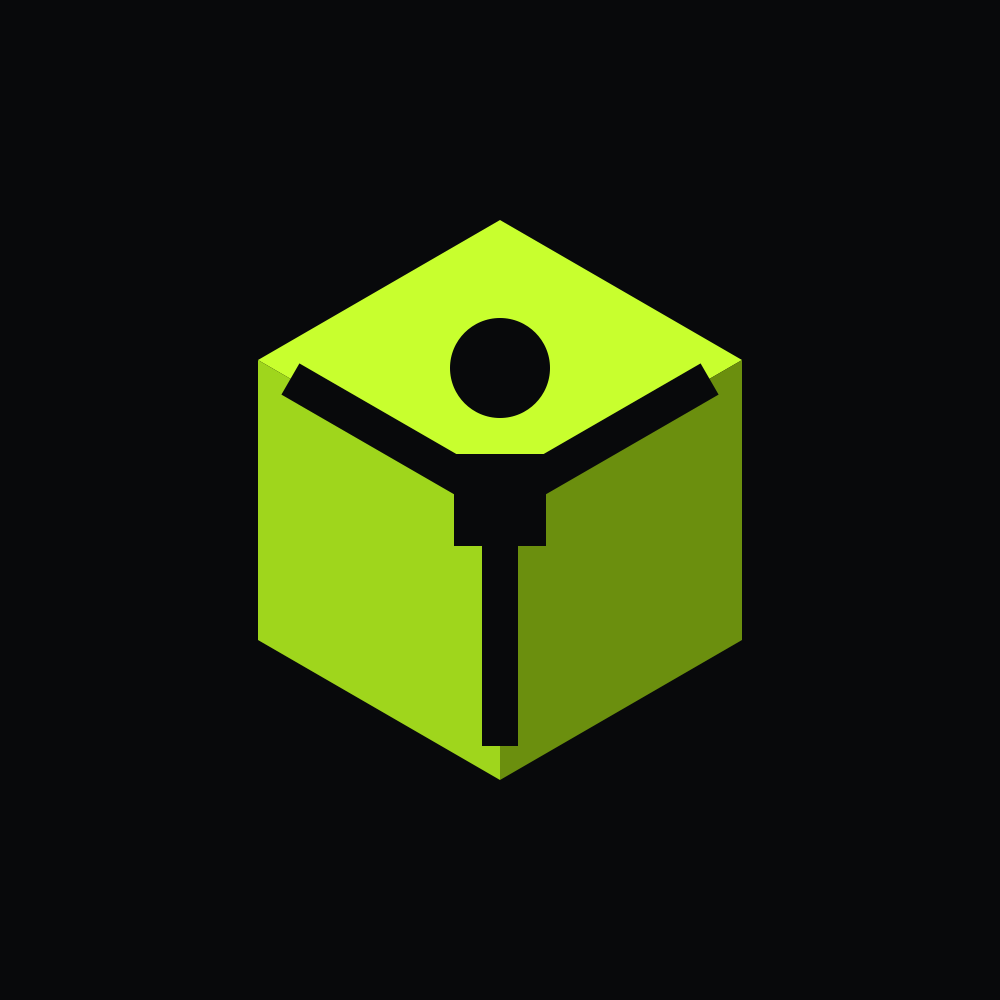

# Tridi



Private company monorepo (`juanevillam/tridi`) for **Tridi** — a Physical AI platform that turns human video, 3D CAD meshes (`.stl`), and industrial piping diagrams (`P&ID .dxf`) into live **MuJoCo** physics simulations and trained controllers (**ONNX** at 50 Hz, deterministic native C/Arduino firmware, and **ISA-5.1 / IEC 61131-3** PLC blocks) ready for zero-shot Sim-to-Real transfer.

One shared physics engine (`MuJoCo` in Python for PPO reinforcement learning and compiled to WebAssembly at 500 Hz in the browser) powers three hardware verticals: **Humanoids** (`Unitree G1`, `Unitree H1`), **Autonomous Rovers & Mechatronics** (`luigi_lab3`, `luigi_lab4`), and **Industrial Plants & PLC Cells** (`factory_cell` and `P&ID .dxf` process lines).

- **Production Web (`trytridi.com`):** [trytridi.com](https://trytridi.com)
- **Interactive 3D Simulations Studio:** [trytridi.com/#/simulations](https://trytridi.com/#/simulations)
- **Factory & CAD Assembler (`P&ID .dxf` + `.stl`):** [trytridi.com/#/assembler](https://trytridi.com/#/assembler)
- **Real-World Sim-to-Real Case Studies:** [trytridi.com/#/milestones](https://trytridi.com/#/milestones)
- **Executive Roadmap & Team Task Board:** [`docs/ROADMAP.md`](docs/ROADMAP.md) · **Documentation Index:** [`docs/README.md`](docs/README.md)
- **Brand Manual (by José Alejandro):** [`docs/pitch/manual-de-marca-tridi.pdf`](docs/pitch/manual-de-marca-tridi.pdf) · **Platanus Hack 26 Pitch Deck:** [`docs/pitch/tridi-pitch.pdf`](docs/pitch/tridi-pitch.pdf)
- **Y Combinator Winter 2027 Application (Private):** [`yc/README.md`](yc/README.md) · [`yc/yc-w27-reference.md`](yc/yc-w27-reference.md)

## Layout

| path | what it is |
| --- | --- |
| `data/` | **Capture 2.0 & Industrial Ingestion** — phone/webcam video → 3D world-space `PoseClip` v2 (`GVHMR` SMPL-X body + `WiLoR` 21-joint hands), WebSocket relay (`data/relay.py`), AutoCAD `P&ID (.dxf)` parser (`data/pid_parser.py`), and video API server (`data/server.py`) → [README](data/README.md) |
| `physics/` | **MuJoCo WASM Engine & Assemblers** — `Unitree G1`/`H1` humanoids, `luigi_lab3`/`luigi_lab4` rovers, `factory_cell` packaging line, 14 hardware catalog components (`physics/components/catalog.json`), `ISA-5.1` catalog (`isa_standard.json`), and deterministic CAD/P&ID assemblers (`assembler.js`, `pid_assembler.js`) → [README](physics/README.md) |
| `training/` | **RL Training & Sim-to-Real Compilers** — PPO / DeepMimic training (`ppo.py`, `imitate.py`, `multiclip.py`, `luigi_lab4_env.py`), 11 pretrained `ONNX` policies (`training/policies/`), `ONNX → C99 / Arduino (.ino)` compiler (`export_mcu.py`), and `PLC (.scl / .L5K)` exporter (`export_plc.py`) → [README](training/README.md) |
| `web/` | **Production Web App (`trytridi.com`)** — bilingual ES/EN SPA built with Three.js + MuJoCo WASM + Vite (`Landing`, `Simulations`, `Factory Assembler`, `Live Camera`, `Upload Video`, `Delivery & Code`, `Case Studies`) → [web/](web/) |
| `docs/` | **2-Layer Documentation & Raw Archive** — Layer 1 human entry & roadmap ([`docs/README.md`](docs/README.md), [`docs/ROADMAP.md`](docs/ROADMAP.md), [`docs/estado.md`](docs/estado.md)), Layer 2 engineering manuals ([`docs/architecture-and-sim2real.md`](docs/architecture-and-sim2real.md), [`docs/infra-and-security.md`](docs/infra-and-security.md), [`docs/contrato.md`](docs/contrato.md)), and raw pitch/brand/meeting archives (`docs/pitch/`, `docs/reuniones/`) |
| `yc/` | **Y Combinator W27 Dossier (Private)** — verbatim submitted application (`yc-w27-reference.md`), verified metrics (`verdad-hoy.md`), competitor breakdown (`competidores.md`), and founder scripts → [README](yc/README.md) |
| `scripts/` | **Git, Cloud & Audit Automation** — branch setup (`setup.sh`), squash-merge shipper (`ship.sh`), Cloudflare DNS/WAF/Pages idempotent provisioner (`cloudflare-setup.mjs`), and session bitácora hooks |

## Three Verticals on One Physics Engine

| Vertical | Input | MuJoCo Digital Twin & Training | Deliverable (`#/delivery` & `#/assembler`) |
| --- | --- | --- | --- |
| **1. Humanoid Robotics** (`Unitree G1` · `H1`) | Phone video (`.mp4`) or Live Camera / QR (`30 fps`) | Kinematic retargeting (`< 3.2 cm` error) + PPO training across 4 perturbed worlds (`flat`, `rocks`, `slippery`, `wind`, up to `350 N` pushes) + 3D robotics bay with live joint/foot telemetry tags | `policy.onnx` (`265 KB`, `50 Hz`, `< 1 ms`), `motion.json`, `poseclip.json`, and `dataset.zip` |
| **2. Autonomous Rovers & Mechatronics** (`luigi_lab3` · `luigi_lab4`) | 3D CAD meshes (`.stl`) + Arduino `.ino` pinout | Automatic MJCF assembly (`assembler.js`), hardware timer/interrupt validation (`Timer1` vs `<Servo.h>`, zero-blocking `ISR` ultrasound), and 3D lab arena (`3.4 m × 3.4 m`) with live 7-ray ultrasonic/IR cone | Zero-heap C99 / Arduino `.ino` firmware (`export_mcu.py`, `max_abs_diff < 1e-5` vs ONNXRuntime, `461 B` RAM) + WebSerial bridge |
| **3. Industrial Plants & P&ID Cells** (`factory_cell` · `P&ID .dxf`) | AutoCAD `P&ID (.dxf)` diagram or industrial cell spec | Deterministic `ISA-5.1` equipment graph (`pid_assembler.js`), closed-loop sensor synchronization (`0%` crushed boxes under belt slip vs fixed PLC timers), and 3D industrial floor with live ISA tags (`CV-101`, `CYL-201`, `PRS-301`) | 1. **ISA-5.1 / ISA-88 FDS Documentation** (`.md`) · 2. **Custom 3D Simulation** (`.xml`) · 3. **PLC Flat File** (`Siemens TIA Portal .scl` & `Rockwell Studio 5000 .L5K`) |

## Develop

```sh
./scripts/setup.sh                                              # configure git hooks and create personal branch <name>/<topic>

npm --prefix physics run check                                  # run all 12 physics, retargeting, catalog, and P&ID suites
npm --prefix data/live run check && npm --prefix data/live run check-relay
npm --prefix web run check                                      # verify 586+ ES/EN i18n keys, links, and UI invariants
npm --prefix web run build                                      # production Vite bundle into web/dist/

npm --prefix web run dev -- --port 5199                         # local dev server (trytridi.com SPA)
uv run --project training python -m training.export_mcu --preset luigi_lab4
uv run --project training python -m training.export_plc --dxf data/pid_samples/01_batch_mixer.dxf --vendor rockwell

./scripts/ship.sh "feat(scope): summary"                        # squash-merge branch into main and push to origin
```

## Documentation (2-Layer Standard)

- **Layer 1 (Human Entry, Strategy & Team Roadmap):**
  - [`docs/README.md`](docs/README.md) — master index separating active daily docs from historical/raw context archives.
  - [`docs/ROADMAP.md`](docs/ROADMAP.md) — 3-minute executive summary, status of every production surface, ASCII architecture diagram, and team task board (`J-*`, `P-*`, `C-*`, `A-*`).
  - [`docs/estado.md`](docs/estado.md) — live status per area (`data/`, `physics/`, `training/`, `web/`, `yc/`).
- **Layer 2 (Deep Engineering Manuals):**
  - [`docs/architecture-and-sim2real.md`](docs/architecture-and-sim2real.md) — full technical manual for Capture 2.0, MuJoCo retargeting, PPO/Mimic training, `ONNX → C99` MCU compiler, `P&ID (.dxf) → ISA-5.1 + 3D + PLC` pipeline, and 3D stage architecture.
  - [`docs/infra-and-security.md`](docs/infra-and-security.md) — Namecheap, Cloudflare DNS/SSL/HSTS/WAF/Pages (`trytridi.com`), anti-spoofing (`SPF`/`DMARC`), GitHub Actions CI/CD, and video tunnel architecture.
  - [`docs/contrato.md`](docs/contrato.md) — shared JSON schemas (`PoseClip`, `RobotMotion`, `DeliveryManifest`, `HardwareCatalog`, `IsaEquipmentGraph`).
- **Raw Context Archive (Brand, Pitch, Field Meetings & Audio):**
  - [`docs/pitch/manual-de-marca-tridi.pdf`](docs/pitch/manual-de-marca-tridi.pdf) (Brand Manual designed by **José Alejandro**) & [`docs/marca.md`](docs/marca.md).
  - [`docs/pitch/tridi-pitch.pdf`](docs/pitch/tridi-pitch.pdf) (Platanus Hack 26 official pitch deck).
  - [`docs/reunion-zaka.md`](docs/reunion-zaka.md) + raw audio [`docs/reuniones/2026-11-12-reunion-zaka-audio.m4a`](docs/reuniones/2026-11-12-reunion-zaka-audio.m4a) + raw Whisper transcript [`docs/reuniones/2026-11-12-reunion-zaka-transcripcion-raw.txt`](docs/reuniones/2026-11-12-reunion-zaka-transcripcion-raw.txt).
  - [`docs/caso-luigi-sim2real.md`](docs/caso-luigi-sim2real.md) (Luigi Lab 3 & Lab 4 physical Sim-to-Real manual).

## Standards & Team

[`AGENTS.md`](AGENTS.md) and [`CONTRIBUTING.md`](CONTRIBUTING.md) define the mandatory git workflow (never commit on `main`, small conventional commits, automatic 2-layer documentation sync before shipping, and session logs in `docs/bitacora/`). **`yc/` is strictly private to `juanevillam/tridi` and must never be pushed to any public mirror.**

- **Pastor Jiménez** ([@torpass](https://github.com/torpass)) — CEO · Physics Engine, Retargeting, 3D Render & Hardware Catalog (`physics/`, `training/`)
- **Juan Esteban Villa Mendoza** ([@juanevillam](https://github.com/juanevillam)) — CTO · Data Pipeline, RL/MCU/PLC Compilers, Web Architecture & Infra/Security (`data/`, `training/`, `web/`, `docs/`)
- **César Martínez** ([@cisorm](https://github.com/cisorm)) — CIO/CTO · Web App & Assembler Screens (`web/`)
- **Alejandra Hernández** ([@alehernandezt](https://github.com/alehernandezt)) — COO · Industrial Strategy, Unit Economics, Customer Discovery & YC W27 (`docs/`, `yc/`)

Born at **Platanus Hack 26**, Caracas (October 23–25, 2026). Frozen hackathon archive: [platanus-hack/platanus-hack-26-ve-team-26](https://github.com/platanus-hack/platanus-hack-26-ve-team-26).
