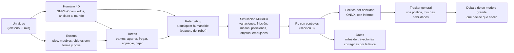

# Plan Tridi v2: un video, millones de prácticas, cualquier humanoide

- **Fecha:** 2026-11-03 (v2 del plan, reescrita el mismo día con la visión de Juan) · **Quién:** Juan, con Claude.
- **Rama:** `juan/experimental` en `juanevillam/tridi` (privado). Nunca en `main` sin hablarlo con el equipo; nunca en `Torpass/tridi`. Nada de esta rama despliega: la demo (https://tridi-alpha.vercel.app) queda como se mandó a YC.
- **Dueño:** Juan, de punta a punta. Se muestra a Pastor, César y Ale cuando esté avanzado.
- **Base:** lo que funciona y lo que no al 27 de octubre, en [`../yc/verdad-hoy.md`](../yc/verdad-hoy.md); el plan del hackathon, en [`plan-producto.md`](plan-producto.md).

---

## 0. La visión, en palabras de Juan

> En vez de grabarme un millón de veces lavando platos, grabo **un** video de 3 minutos lavando muchos tipos de cosas. Metemos al robot simulado en una física tan fiel a la realidad como sea posible, y por reinforcement learning le enseñamos a lavar: repite ese video millones o miles de millones de veces, con platos resbalosos, un plato demasiado cerca del borde que se cae, otra cocina, otro robot. Lo que hace falta es cómputo, no más videos.

Tres ideas sostienen todo el plan:

1. **Un video → miles de variaciones.** El video da la *intención* y la *forma* del movimiento; la simulación da la *variedad* (fricción, masas, posiciones, empujones, objetos, cocinas) y la *física* (lo que se cae, lo que resbala, lo que pesa). El robot no copia un video: aprende la habilidad que el video muestra.
2. **Cualquier humanoide.** Va a haber muchos fabricantes (Unitree, Tesla Optimus, Figure, 1X, Apptronik, Fourier, Booster…), con tamaños, articulaciones y manos distintas. El software recibe el modelo del robot y se adapta: nunca algo atado al G1.
3. **Debajo del modelo grande.** Los robots van a tener un modelo de lenguaje o visión-lenguaje-acción que decide *qué* hacer ("lava ese plato"). Tridi entrega el *cómo* con el cuerpo: las políticas de bajo nivel, rápidas y físicamente robustas, que ejecutan esa orden sin tirar el plato.

### Frente a Asimov (YC, el más parecido)

[Asimov](https://tryasimov.ai/) junta datos humanos reales a escala: personas con el teléfono en la cabeza haciendo tareas en cocinas, oficinas y hoteles de tres continentes, con anotaciones de pose 3D, profundidad y actividad. Su apuesta: **más datos reales**. La nuestra es la otra mitad: **multiplicar cada video con física y RL**. No compiten de frente: un dataset de Asimov (o del cliente) podría ser la entrada de Tridi. Esta diferencia va al pitch cuando sea verdad y esté medida.

---

## 1. Las reglas del juego (decididas por Juan el 2026-11-03)

| Regla | Qué implica |
| --- | --- |
| **Cómputo: solo la Mac de Juan (MacBook Air M2, 16 GB, sin ventilador).** Nada en la nube, ni gratis | Física de MuJoCo en CPU con todos los núcleos; entrenar un video 24 h está bien (20 videos = un mes, aceptado). La GPU del M2 (MPS) hoy es más lenta que la CPU para esta red chica (10,1 k contra 11,2 k pasos/s, medido): se usa cuando la red crezca. La eficiencia por paso importa tanto como la cantidad |
| **La Mac es de trabajo: que no se queme** | Guardián en cada entrenamiento ([`training/guard.py`](../training/guard.py)): fondo cuando Juan la usa, pausa a batería, caliente o con poca memoria, reanudar después de cualquier corte ✅ |
| **Solo herramientas gratis y seguras** | Código abierto, corriendo local. Ningún video sale de la Mac. Licencia de cada modelo y dataset anotada antes de usarlo (sección 10) |
| **Manos de 5 dedos** | El primer robot con manos: G1 + manos de 5 dedos tipo Inspire (6 motores por mano). Las Dex3 (3 dedos) que ya están en `physics/models/dex3` quedan como segunda mano, para probar que el retargeting de manos no está atado a una sola |
| **Cualquier video, cualquier cámara** | Funciona con lo que la gente ya tiene: TikTok, YouTube, Instagram, stock, la cámara de la Mac o del teléfono en la mano; una persona o un grupo bailando. Nada de trípode ni condiciones de estudio. El set de prueba son videos reales de internet, no grabaciones de Juan |
| **Cualquier humanoide** | Desde el primer bloque hay un **segundo robot** en las pruebas, para que nada se ate al G1 sin darnos cuenta |
| **Que no vuelva a pasar lo de la caminata** | Ningún entrenamiento largo sin pasar los controles de la sección 3 |

---

## 2. Dónde estamos (con números)

| Pieza | Hoy | El límite real |
| --- | --- | --- |
| Captura | YOLO11 + ByteTrack + MediaPipe, **33 puntos**, sin dedos, cada cuadro por separado, trayectoria por heurísticas | De frente el avance sale ≈ 0; escala 10-20 % baja; sin objetos |
| Escena | `data/scene.py`: cajas de muebles del primer cuadro (YOLO) | Sin geometría real, sin objetos que se mueven |
| Retargeting | Ángulos de 33 puntos → 29 articulaciones del G1, 3,2 cm de error mediano | Sin manos, sin objetos, solo el G1 |
| Entrenamiento | PPO propio, CPU, **~11.400 pasos/s** (64 robots, 8 procesos). De pie 60 M pasos. Caminata `walk-v4`: **3,5 s de 11,8**, y de 10 M a 20 M pasos no mejoró (3,68 → 3,54 s) | El método se estancó, no solo la cantidad |
| Web | Landing en ES/EN sin recargar (esta rama), el resto en español | — |

**Qué pasó con la caminata, honestamente:** los diagnósticos de `plan-producto.md` ya lo decían. La red aprendió a no caerse, pero el robot se quedaba 0,5 m atrás de la referencia, caderas y tobillos iban 60-100 ms tarde, y los episodios se cortaban por alejarse del recorrido. Más pasos no arreglan una referencia que el robot no puede seguir, ni una recompensa que castiga quedarse atrás en vez de enseñar a alcanzarla. Eso se detecta en horas, no en días: es lo que hacen los controles de abajo.

---

## 3. Controles contra el estancamiento (antes, durante y después de entrenar)

Esta sección es obligatoria para todo entrenamiento de más de 1 hora. Se implementa en el **bloque 1**, antes de cualquier cosa nueva.

### Antes de entrenar: ¿se puede aprender esto?

| Control | Qué mide | Pasa si |
| --- | --- | --- |
| **C1. Referencia factible** | La referencia jugada por los motores con la pelvis sostenida (`diagnose_reference.py`, ampliado): error por articulación, retraso de cada motor, pies que se hunden o flotan, articulaciones en el límite | Error medio < 5 cm, ningún motor > 40 ms tarde, < 2 % de cuadros en el límite |
| **C2. Física factible** | Fuerzas y torques que la referencia pediría (dinámica inversa) contra los límites de los motores del robot | Ningún tramo pide > 100 % del torque máximo |
| **C3. Sobreajuste chico** | Entrenar solo 1 s del clip, 2 M pasos | Lo sigue entero. Si no puede con 1 s, no va a poder con 12 s: el problema está en la recompensa o la observación |
| **C4. Humo** | 1 M pasos de la configuración completa | La recompensa sube y la duración de los episodios crece |

### Durante: ¿sigue aprendiendo?

- **Evaluación fija cada escalón** (0, 1 M, 3 M, 10 M, 30 M, 100 M…; ya existe en `ppo.py`): `followed_s`, error de seguimiento, éxito en N episodios, y robustez en los 4 mundos. Siempre con las mismas semillas, para que dos puntos se puedan comparar.
- **Mapa de dónde se cae:** el clip partido en tramos de 0,5 s y, por tramo, qué porcentaje de episodios se cae ahí. Dice *dónde* está el problema (en la caminata habría mostrado el tramo de la primera zancada) y alimenta el **muestreo adaptativo**: se practica más donde más se cae.
- **Salud del aprendizaje:** entropía y desvío de la exploración, KL entre actualizaciones, varianza explicada del crítico, norma de los gradientes. Cada uno con su rango sano escrito al lado; fuera de rango → aviso.
- **Detector de meseta:** si en las últimas 3 evaluaciones `followed_s` y el éxito no mejoran más de 2 % cada una, el entrenamiento **para solo** y escribe un informe: curva, mapa de caídas, salud, y la sospecha (referencia, recompensa, exploración, capacidad de la red). Así nunca se gastan 24 h de la Mac en algo que dejó de mejorar a las 3.
- **Regla de la década:** cada 10× de pasos tiene que dar al menos +10 % en la métrica principal. Si una década no lo da, se cambia el método, no se suma otra década.

### Después: ¿de verdad mejoró?

- **Registro de experimentos** (`training/experiments/registro.csv` o similar): cada corrida con su commit, configuración, semilla, pasos, tiempo, métricas finales y una línea de "qué se cambió y por qué". Un cambio a la vez contra una base conocida.
- **Dos semillas** para cualquier decisión que cambie el método (no para cada corrida): una sola semilla puede mentir.
- **Clips que no vio:** toda política general se mide en clips que nunca vio al entrenar.

---

## 4. La cadena v2, de punta a punta

---

## 5. Pilares

### A. Web (lo primero que se ve)

- ✅ **Idiomas sin recargar en la landing** (`web/src/i18n.js`, `web/src/landing/strings.js`), con el patrón del portafolio de Juan.
- ✅ **Congelón de ~1 s al llegar a Capture**: el esqueleto se arma con la página ociosa. Falta medirlo de nuevo con el panel visible.
- ⏳ Idiomas en En vivo, Subir, Simulaciones, Entrega, Cámara y Red. Chequeo que falle si queda un texto en un solo idioma.
- ⏳ Presupuesto de fluidez: ningún cuadro > 50 ms al hacer scroll. Física en un Web Worker.
- ⏳ Más adelante: selector de robot y de mano en Simulaciones (pilar D se ve en la web).

### B. Captura 2.0: el humano en 4D, con dedos

Todo local en la Mac (PyTorch con MPS, o CPU si un modelo no corre en MPS: en offline la velocidad importa poco).

| Qué | Candidatos (código abierto, licencia por revisar) | Por qué |
| --- | --- | --- |
| Cuerpo anclado al mundo, cámara que se mueve | **GVHMR**, WHAM, TRAM | Trayectoria global y gravedad: reemplaza las heurísticas de `lift.py` y arregla "de frente el avance sale ≈ 0" |
| Manos con dedos | **HaMeR**, WiLoR | Modelo de manos dedicado sobre el recorte de cada mano: 15 articulaciones por mano |
| Puntos 2D densos | RTMW / DWPose (133 puntos), Sapiens | Pies con talón y punta (contacto) y validación |
| Persona + escena juntas | VideoMimic (Berkeley, 2025) como referencia de método | Reconstruye humano y entorno de un video de teléfono para entrenar al G1: es lo más cercano a Tridi publicado; leer y medir contra él |

**Pipeline:** seguir personas (como hoy) → cuerpo en el mundo → manos → fusión en **SMPL-X** → **refinamiento con física**: pies que no patinan ni atraviesan el piso, manos que no atraviesan objetos, aceleraciones humanas posibles.

**`PoseClip` v2** (contrato primero, en commit aparte): parámetros SMPL-X por cuadro, contactos de pies y manos, confianza por articulación, cámara. Los 33 puntos siguen saliendo, derivados, para que nada de hoy se rompa.

**Medida (set de prueba, bloque 1):** videos reales de internet por habilidad (Pexels primero: licencia libre, también comercial; TikTok, YouTube e Instagram para probar en la Mac), con `data.testset` y la nota de calidad `data.quality`; guía en [`grabacion/set-de-prueba.md`](grabacion/set-de-prueba.md). Lo que la captura 2.0 tiene que aguantar: cámara en la mano, de frente, vertical, poca luz, varias personas (elegir a una o entregar a todas), cortes de edición (sirven además como datos con licencia propia): caminar de perfil y de frente, girar, agacharse, sentarse, gestos, contar con los dedos, agarrar y dejar objetos, dos personas. Métricas sin verdad de terreno: patinazo del pie, pies bajo el piso, temblor, largo de huesos constante, cuadros válidos, altura. Línea de partida (MediaPipe, caminata): el pie apoyado patina 0,87 m/s y los huesos cambian 6,4 % de largo. Con verdad de terreno (opcional): dos grabaciones de Juan, distancia de 3 m y su altura medida.
**Meta:** patinazo < 2 cm/s; distancia con < 5 % de error de frente y de perfil; dedos legibles en ≥ 90 % de los cuadros con la mano visible.

### C. Escena y objetos: la cocina del video, en la simulación

El salto que separa "un robot que imita un baile" de "un robot que lava platos".

1. **Geometría estática:** el piso, la mesada, el fregadero, como cajas y planos ubicados en metros (profundidad monocular + el piso que ya estimamos). Empieza con primitivas simples: para el contacto importa la superficie, no el detalle.
2. **Objetos que se mueven:** detectar y seguir cada objeto (plato, vaso, cubierto) cuadro a cuadro, su pose 6D y una forma aproximada (primitiva, o una malla generada si el modelo es abierto y corre local).
3. **Física de los objetos:** masa, fricción y, sobre todo, **rangos**: el plato mojado tiene fricción baja y al azar en cada episodio. Así aparece solo "el plato demasiado cerca del borde se cae": nadie lo programa, la física lo hace y el robot aprende a evitarlo.
4. **Tareas:** partir el video en tramos (agarrar, fregar, enjuagar, dejar) por los contactos mano-objeto. Cada tramo es una habilidad con su recompensa: seguir la mano humana *y* llevar el objeto a donde lo llevó el humano (lo segundo pesa más: importa el plato, no copiar cada dedo).

MuJoCo tiene cuerpos rígidos excelentes y deformables (flex) para tela simple; agua no. Agua y espuma no se simulan: el "lavado" se aproxima con contacto y movimiento de la esponja sobre el plato. Lo escribimos así para no prometer lo que no hay.

### D. Cualquier humanoide: el paquete del robot

Un robot entra a Tridi como un **paquete**: su modelo MuJoCo (MJCF; o URDF convertido), un archivo de correspondencias (qué cuerpo del robot es la pelvis, las manos, los pies, la cabeza; qué dedos tiene), sus límites y motores, y su mano.

- **Retargeting por cinemática inversa con restricciones** (al estilo GMR, que ya soporta varios humanoides desde SMPL-X): empareja posiciones y orientaciones de pies, manos, pelvis y cabeza con **escala por el largo de los huesos** del robot (Optimus no mide lo que mide un Figure), con límites, sin atravesar el piso, sin patinar cuando el humano apoya, y conservando el contacto con los objetos (como OmniRetarget).
- **Manos:** retargeting de dedos por la dirección de cada dedo y los puntos de contacto con el objeto, no por ángulos: así sirve para 5 dedos (Inspire), 3 dedos (Dex3) o una pinza.
- **Robots de prueba:** G1 (+ Inspire, + Dex3) y un segundo humanoide de otro tamaño de MuJoCo Menagerie (Unitree H1 u otro), desde el bloque 2. Si algo funciona en uno y no en el otro, se arregla antes de seguir.
- **Meta:** sumar un humanoide nuevo = escribir su paquete (< 1 día), sin tocar código.

### E. Entrenamiento 2.0 en la Mac

La M2 tiene 8 núcleos y 16 GB. El plan saca todo lo posible de ahí, porque "24 h por video" está bien, pero 24 h desperdiciadas no.

1. **Más pasos por segundo en CPU**, medido antes y después: `mujoco.rollout` (pasos en C con varios hilos, sin pasar por Python en cada paso), menos trabajo de Python por paso, red en el proceso principal con lotes grandes, contactos solo donde importan. Meta: ≥ 2× los 11.400 pasos/s de hoy en el robot sin manos.
2. **Aprender más por paso** (eficiencia de muestras): crítico asimétrico, inicio en estados al azar del clip, terminación temprana, muestreo adaptativo (sección 3), currículum (primero el clip lento, después a velocidad real; primero objetos que no se resbalan, después sí), y comparar PPO con un método fuera de política moderno (como FastTD3/SAC con muchos robots en paralelo), que suele necesitar menos pasos.
3. **Recompensa en dos capas:** imitar al humano (estilo) + lograr la tarea (el plato llega al escurridor). Para manipulación, controladores virtuales que al principio "ayudan" a mover el objeto y se van retirando (como DexMachina) para que el robot no tenga que descubrir todo solo.
4. **Del tracker por clip al tracker general:** primero una política por habilidad; después una sola política que sigue cualquier movimiento (destilando las de cada clip). Con ella, "Muévete y el robot te copia" pasa a tener física real en tiempo real.
5. **Política estudiante:** solo con lo que el robot real tiene (sin la altura exacta de la pelvis, con ruido y retardo), destilada de la maestra. Es la que se entrega para un robot de verdad.

**Cuánto entra en la Mac** (a medir en el bloque 2): a ~11.400 pasos/s, 24 h ≈ 1.000 M de pasos para el cuerpo sin manos. Con manos y objetos la física es más cara (más contactos): esperar 2-5× menos pasos/s, o sea 200-500 M por día. Por eso los puntos 1 y 2 importan tanto como el tiempo.

**Cuántos pasos:** los que la métrica justifique. Se entrena hasta que el detector de meseta diga que paró de mejorar, con la regla de la década (sección 3). Ni un número fijo ni infinito.

### F. Producto

- **"Muévete y el robot te copia":** con el tracker general, física real y manos.
- **"Sube un video":** de la cola de la Mac a un informe por pasos: reconstrucción, controles C1-C4, entrenamiento con su curva y su mapa de caídas, entrega.
- **"La entrega":** política (ONNX + PyTorch + configuración de observación/acción + un script corto para correrla), movimiento humano en SMPL-X y BVH, movimiento del robot en formato LeRobot además del nuestro, datos de miles de variaciones, e **informe de calidad** legible en 2 minutos. Por robot: la misma entrega para cada paquete de robot.
- **Interfaz para el modelo grande:** cada habilidad expone un nombre y sus parámetros ("agarrar(objeto)", "dejar(lugar)"), para que un modelo de lenguaje o VLA la llame. Se diseña cuando haya al menos 3 habilidades.

### G. Robot real (general, no atado a un fabricante)

Modelo de actuadores por robot en su paquete (retardo, torque, fricción), aleatorizado; solo sensores reales en la estudiante; y una prueba en un humanoide real cuando un laboratorio o empresa nos preste uno. Nada se afirma sobre robots reales hasta entonces.

---

## 6. La escalera de habilidades

Cada escalón usa todo lo anterior y prueba algo nuevo. No se sube sin la medida del escalón anterior en verde.

| Escalón | Habilidad | Prueba que… | Medida de "listo" |
| --- | --- | --- | --- |
| **1** | Caminar el clip entero (11,8 s) | Los controles de la sección 3 arreglan lo que nos pasó | ≥ 90 % de episodios llegan al final, en 2 semillas |
| **2** | Gestos de brazos y manos (saludar, señalar, contar con 5 dedos) | Captura de dedos y manos de 5 dedos | Error de punta de dedos < 2 cm en el robot |
| **3** | Movimientos con el entorno: sentarse, subir un escalón, apoyarse | Escena estática del video | ≥ 80 % de éxito en 4 variaciones de la escena |
| **4** | Agarrar y dejar un objeto rígido (taza, plato seco) | Objetos con pose y física | El objeto llega a ±5 cm del destino en ≥ 80 % |
| **5** | Plato resbaloso, mesada mojada, borde cerca | Rangos de fricción: la física enseña sola | No se cae el plato en ≥ 90 % con fricción al azar |
| **6** | Lavar: secuencia agarrar-fregar-enjuagar-dejar, varios objetos, de un video de 3 min | Tareas encadenadas | Secuencia completa en ≥ 70 % |
| **7** | Lo mismo en un segundo humanoide | Paquete del robot | Misma medida que en el G1, ± 10 % |
| **8** | Tracker general + órdenes por nombre | Debajo de un modelo grande | 5 habilidades, llamadas por texto, en clips que no vio |

---

## 7. Orden de trabajo (bloques de ~1 semana de tiempo libre)

| Bloque | Qué | Se muestra |
| --- | --- | --- |
| **0 ✅** | Rama, idiomas en la landing, congelón de Capture, este plan | Landing ES/EN |
| **1** | **Controles de la sección 3** en `training/`. ✅ Guardián de la Mac, reanudar, detector de meseta, registro, C1-C4 (`training.checks`), mapa de caídas (`training.failmap`) y salud del aprendizaje. ✅ Set de prueba de videos de internet (`data.testset`, 25 candidatos de Pexels) y nota de calidad (`data.quality`, línea de partida guardada). Idiomas en el resto de la web | ✅ El informe de controles sobre la caminata, que explica por qué se estancó (abajo): C1 y C2 ❌, C3 y C4 ✅ (se puede aprender; lo que se le pide no está en equilibrio) |
| **2** | Pasos/s en la Mac (`mujoco.rollout`, perfilado). ✅ Segundo humanoide cargado: paquetes de robot (`robots/`), Unitree H1, retargeting entre robots, `balance` y entrenamiento por paquete, `training.feasible`. Set de 20 videos | "Antes X pasos/s, ahora Y" |
| **3** | **Escalón 1:** la caminata completa, con los controles. ✅ **Pasado (2026-11-04):** dos semillas llegan al final desde 100 % de los arranques con empujoncito (`walk-nudge-v2-seed0`, `walk-nudge-v3-seed1`; `training.rung1`). Hizo falta: referencia equilibrada, tasa de aprendizaje adaptativa por KL y 25 % de resets en el primer cuadro. Con empujones: 5 % (siguiente) | La caminata entera con física |
| **4** | Captura 2.0 (GVHMR + HaMeR → SMPL-X), `PoseClip` v2 | Antes/después en el set de prueba, con dedos |
| **5** | Retargeting por IK con paquete de robot; G1 + Inspire | El robot con 5 dedos copiando una mano |
| **6** | Escalones 2 y 3 | Gestos y sentarse |
| **7-9** | Escena y objetos (pilar C); escalones 4 y 5 | Agarra un plato y no lo tira aunque resbale |
| **10+** | Escalones 6-8 | Lavar de un video de 3 minutos |

**Lo que dijeron los controles sobre la caminata (2026-11-03):** la referencia **no es factible**, así que más pasos nunca la iban a arreglar.

- C1: con la pelvis sostenida, los pies tocan el piso cuando la referencia lo dice solo el 55 % del tiempo; el pie apoyado patina 0,25 m/s; caderas y tobillos van 100 ms tarde y la red ve 20 ms adelante.
- C2: el centro de masa de la referencia, aun quieto, cae ~17 cm fuera del pie apoyado en el 84 % de los cuadros; con la aceleración (ZMP), fuera en el 93 %. El movimiento no está en equilibrio.
- Mapa de caídas de `g1-walk`: aguanta 2 s desde el 61 % de los inicios; las caídas se juntan entre 4,5 y 8 s.
- Lo mismo (o peor) en jumping jacks y correr: ZMP fuera del apoyo en 95-98 %.

**Hecho (2026-11-03):** `training.balance` pone la referencia en equilibrio (pies fijos, ZMP sobre el pie apoyado por el modelo carro-mesa, IK). Caminata: ZMP fuera 87 % → 2 %, pie que patina 0,25 → 0,01 m/s, C1-C4 en verde. Con eso arrancó el entrenamiento largo del escalón 1 (`walk-balanced-v1`).

Conclusión: el bloque 3 empieza por **arreglar la referencia** (captura que apoye los pies de verdad, retargeting con contactos y un paso de equilibrio que mueva la pelvis hasta que el ZMP quede sobre los pies), y recién después entrena. Es el punto de decisión de abajo, ya resuelto.

**Puntos de decisión:**

- **Fin del bloque 1:** si los controles muestran que la referencia de la caminata no es factible (C1/C2), el bloque 3 empieza por la captura y el retargeting, no por el entrenamiento.
- **Fin del bloque 2:** si la Mac no pasa de ~15 k pasos/s, priorizar eficiencia por paso (método fuera de política, currículum) sobre cantidad.
- **Fin del bloque 5:** si un segundo robot necesita código especial, rediseñar el paquete antes de seguir.

---

## 8. Calidad de ingeniería

- `npm run check` y pruebas de Python antes de cada commit que toque `physics/` o `training/`.
- Tablero de métricas que se actualiza solo (captura, retargeting, entrenamiento, web): el progreso se muestra a los cofundadores con números.
- Cada umbral con su porqué al lado (regla de la casa).
- Rebasar `juan/experimental` sobre `main` cada semana, para que juntarla después no sea imposible. Contratos nuevos versionados (v2 junto a v1).

## 9. Riesgos

| Riesgo | Qué hacemos |
| --- | --- |
| La Mac sola es lenta para manipulación con manos | Eficiencia por paso + controles que cortan lo que no aprende + entrenar de noche y mientras no se usa. Sin nube, por decisión de Juan |
| La Air M2 no tiene ventilador: bajo carga sostenida macOS baja la velocidad | El guardián pausa en estado térmico "serious"; medir en la primera corrida de 24 h cuántas horas reales entrena por día |
| 16 GB de RAM para modelos de visión grandes | Correr cada modelo por separado sobre el video (no todos a la vez), en offline |
| Escalar demasiado a la vez | La escalera de la sección 6: un escalón por vez, cada uno con su medida |
| La rama se aleja de `main` | Rebase semanal |

## 10. Licencias (herramientas gratis y seguras)

Todo corre local; ningún video sale de la Mac. Pero "gratis para usar" no siempre es "gratis para vender":

| Pieza | Licencia (a confirmar al usarla) | Para vender |
| --- | --- | --- |
| MuJoCo, MuJoCo Menagerie | Apache 2.0 (cada modelo de Menagerie tiene la suya) | ✅ |
| SMPL-X, AMASS | Solo investigación | ❌ sin licencia comercial: plan B con un modelo de cuerpo propio o abierto |
| GVHMR, HaMeR, WiLoR, etc. | Varía (varias solo investigación, y heredan la de SMPL/MANO) | Revisar una por una |
| MediaPipe, YOLO11 | Apache 2.0 / AGPL-3.0 (Ultralytics) | AGPL obliga a abrir el código del servicio: revisar antes de vender |

Para investigar y mostrar, se usan. Antes del primer cliente, cada pieza ❌ tiene un reemplazo propio o con licencia.

**Decidido por Juan (2026-11-04):** la captura 2.0 usa SMPL-X (y SMPL/MANO si hace falta) bajo su licencia no comercial. Tridi v2 es un campo de pruebas: investigar y mostrar está bien. Antes de vender, se compra la licencia comercial (Meshcapade la vende) o se cambia por un modelo de cuerpo abierto.

## 11. Preguntas abiertas

Respondidas por Juan el 2026-11-03: todo es de Juan; rama `juan/experimental` en su repo privado; manos de 5 dedos; cómputo en su Mac con herramientas gratis; no se muestra a Pastor antes.

También: nada de GPU en la nube, ni gratis (ningún dato sale de la Mac); Juan graba solo el set de prueba con la guía de [`grabacion/set-de-prueba.md`](grabacion/set-de-prueba.md); la Mac es de trabajo y no se puede quemar.
